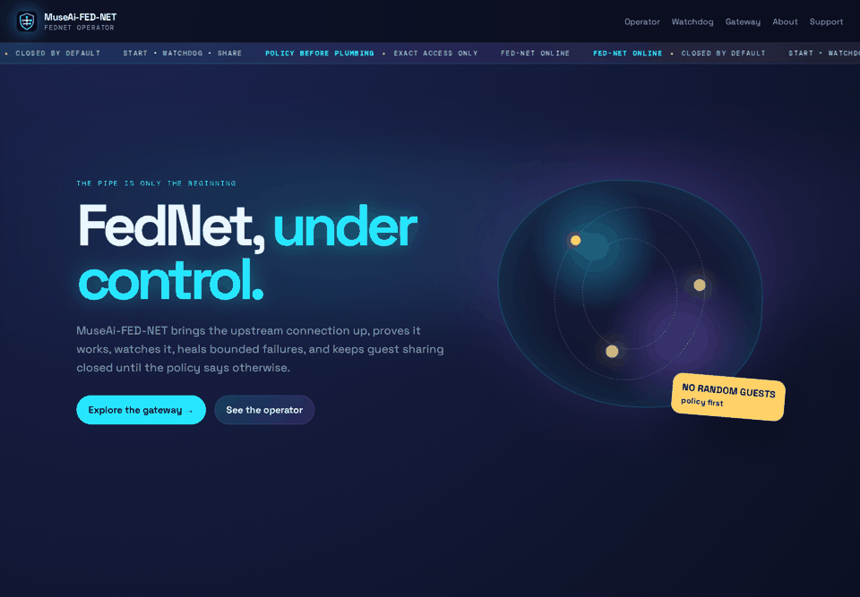
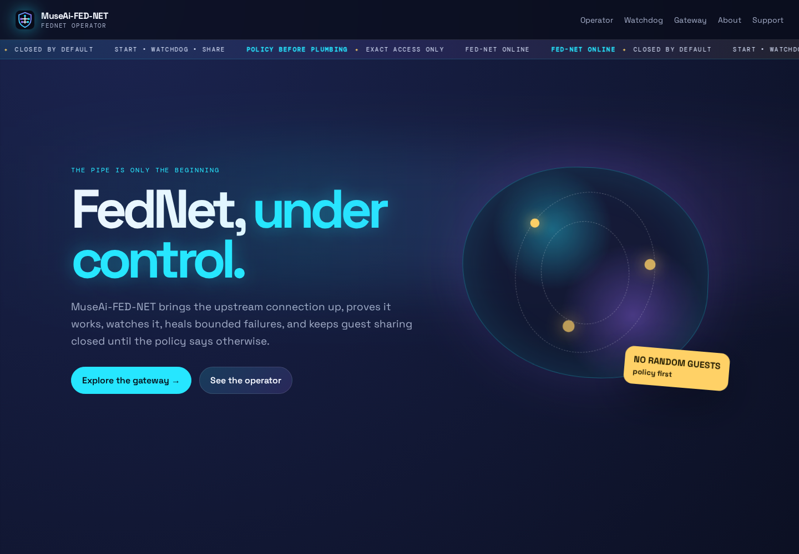
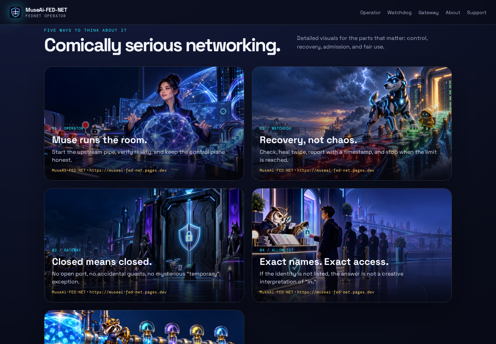
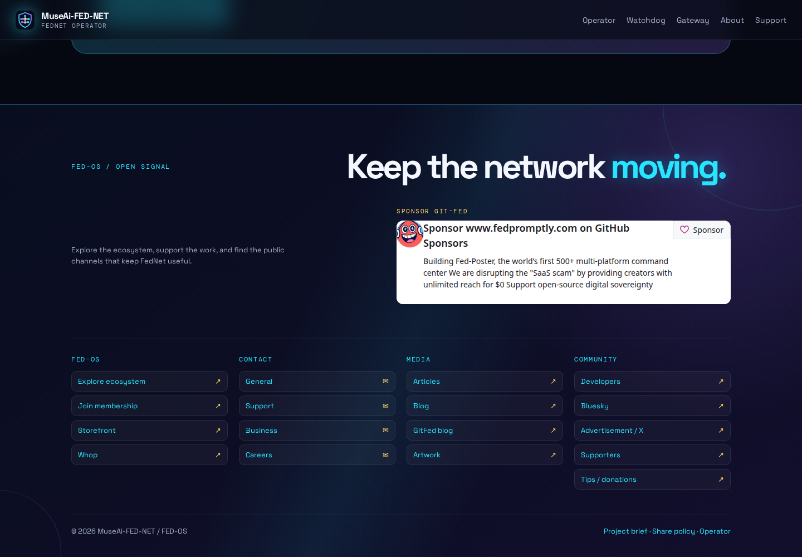

<div align="center">
  
  <h1>MuseAi-FED-NET</h1>
  <p><strong>A Windows operator layer for an Android USB upstream connection with a closed-by-default guest-sharing policy.</strong></p>
  <p>
    <a href="LICENSE"></a>
    <a href=".github/workflows/build.yml"></a>
    <a href="site/"></a>
  </p>
</div>

MuseAi-FED-NET separates two things that are easy to confuse: getting an upstream connection working and sharing that connection with guests. The Android app provides a local SOCKS5 pipe. The Windows operator validates and routes IPv4 traffic through it. The FED-NET policy layer decides separately whether any guest sharing is allowed.

> This repository is a developer-oriented prototype. It is not a polished commercial product, and live tethering requires Windows, an Android phone, administrator access, and the native helper binaries described below.

## Why this exists

Tethering stacks often make the first successful connection look like the whole job is complete. That is risky. A phone connection can be healthy while guest access, forwarding, bandwidth limits, and firewall enforcement remain ambiguous.

MuseAi-FED-NET makes the boundary explicit. **Start** brings up and verifies the upstream path. **Watchdog** monitors it and performs bounded recovery. **Share** stays closed until the operator supplies an explicit listen port, allowlist, forwarding rules, and bandwidth budget.

The intentionally conservative default is useful for developers who need to inspect a tethering stack without accidentally turning a working phone connection into an open gateway.

## See it work

The repository contains a static promotional site that can be previewed immediately. A Pages URL is configured in `site/site-config.js` as [`https://museai-fed-net.pages.dev`](https://museai-fed-net.pages.dev), but it was not reachable during this README update, so it is not presented as a verified live demo.

### Fastest local preview

```bash
python3 -m http.server 4173 --directory site
# open http://127.0.0.1:4173
```

The captured tour below was generated from that real local site, not from a mockup:



The quickest executable verification is the policy test suite:

```bash
python3 -m unittest discover -s tests -v
```

For the actual phone-to-Windows path, see [Run the operator](#run-the-operator). The sandbox cannot live-test the Android connection, Windows route changes, or guest forwarding.

## Screenshots

### Homepage and project framing



### Visual system: operator, watchdog, gateway, allowlist, and bandwidth



### Animated footer and GitHub sponsor card



## Quick start

### 1. Run the policy tests

The tests exercise the safety contract without touching sockets, routes, firewalls, or external services.

```bash
python3 -m unittest discover -s tests -v
```

The suite covers:

- a default gateway that remains `CLOSED-BY-DEFAULT`;
- exact-match guest admission and forwarding-rule lookup;
- token-bucket rejection when a guest exceeds its budget.

### 2. Preview the static site

```bash
python3 -m http.server 4173 --directory site
```

The site has no build command and no server-side router. Publish the `site/` directory as-is. See [`site/README.md`](site/README.md) for the Pages and Cloudflare Pages notes.

### 3. Build the Android APK

The Android module targets SDK 34, has a minimum SDK of 26, and is built by CI with JDK 17 and Gradle 8.2.

```bash
cd android
curl -fsSL https://services.gradle.org/distributions/gradle-8.2-bin.zip -o /tmp/gradle-8.2.zip
unzip -q /tmp/gradle-8.2.zip -d /tmp
/tmp/gradle-8.2/gradle-8.2/bin/gradle assembleDebug --no-daemon
```

The debug APK is written to `android/app/build/outputs/apk/debug/app-debug.apk`.

## Run the operator

The full runtime is Windows-only because it configures a TUN adapter, changes IPv4 route selection, and uses administrator-level PowerShell operations.

Before starting, provide these files under `desktop/`:

- `platform-tools/adb.exe`
- `tun2socks.exe`
- `wintun.dll`

Then:

1. Build or download the Android APK and install it on an Android phone.
2. Enable USB debugging and connect the phone by USB.
3. Build the Windows bundle through the GitHub Actions workflow, or place the helper binaries beside the Python launcher.
4. Run `desktop/run_windows.bat` as Administrator, or start the packaged `OpenTetherRouter.exe`.
5. Watch the console for the IPv4 route check and HTTPS egress test.
6. Press `Ctrl+C` to stop and restore the route/interface state.

The Windows launcher uses ADB to forward local TCP port `1080` to the phone-side SOCKS5 service. It starts `tun2socks`, configures the `OpenTetherTun` adapter, verifies the selected route, and checks `api.ipify.org` over HTTPS. It does not open guest sharing merely because the upstream pipe is working.

## Safety contract

The authoritative policy is [`FED-NET.md`](FED-NET.md), implemented in [`desktop/fed_net.py`](desktop/fed_net.py), and initialized by [`fed-net/gateway.json`](fed-net/gateway.json).

The checked-in gateway configuration is intentionally closed:

```json
{
  "bind_port": 0,
  "allowlist": [],
  "forwarding": [],
  "bandwidth": {"per_guest_kbps": 0, "burst_kb": 0}
}
```

`GatewayPolicy` reports `OPEN-CONFIGURED` only when all required controls are explicit. Guest identities use exact matching. Forwarding uses an exact protocol-and-port lookup. `GuestRateLimiter` provides a token-bucket primitive for a separate enforcement engine.

The policy module itself does **not** open sockets or modify Windows firewall rules. That separation is deliberate: a platform enforcement layer must consult the policy before it admits, forwards, or rate-limits guest traffic.

## Known limitations

- IPv4 TCP is the supported path; IPv6 and UDP are not tunneled by the current Android SOCKS5 service.
- IPv6 traffic may leak unless it is disabled or separately managed on physical adapters.
- DNS behavior depends on Windows interface selection and policy.
- Hard process termination can leave routes behind; normal shutdown performs cleanup and restores interface metrics when possible.
- The Android service is a basic local SOCKS5 proxy. It does not implement Android `VpnService` or UDP `ASSOCIATE`.
- Live proof requires hardware and native Windows dependencies that are unavailable in this sandbox.

## Repository map

```text
android/                 Android upstream SOCKS5 app
  app/                   Gradle application module
desktop/                Windows operator, watchdog loop, and launch script
fed-net/                Closed-by-default gateway policy configuration
site/                   Static project landing site
  assets/               Brand and promotional image assets
tests/                 Python policy tests
FED-NET.md              Authoritative architecture and safety contract
.github/workflows/      Android and Windows build workflow
```

## CI and artifacts

[`build.yml`](.github/workflows/build.yml) runs two build jobs on pushes and pull requests targeting `main`:

- **Android:** JDK 17, Gradle 8.2, and a debug APK artifact named `MuseAi-FED-NET-APK`.
- **Desktop:** Windows, `tun2socks`, Wintun, Android platform-tools, PyInstaller, and a packaged `OpenTetherRouter` artifact named `MuseAi-FED-NET-Desktop`.

The workflow is present in the repository. A repository-specific public Actions status badge is not included because the canonical GitHub repository URL is not available in the project files.

## All repository images

The following section intentionally embeds every image asset currently checked into the repository, including the brand marks, five promotional visuals, and the locally captured demo media.

### Brand marks


### Promotional visuals


### Captured site media


## Contributing

Start with the policy contract and tests when changing gateway behavior. Keep the safe default closed, add a focused regression test for policy changes, and document any new Windows or Android dependency in the build workflow and operator instructions.

## License

MIT. See [`LICENSE`](LICENSE).
